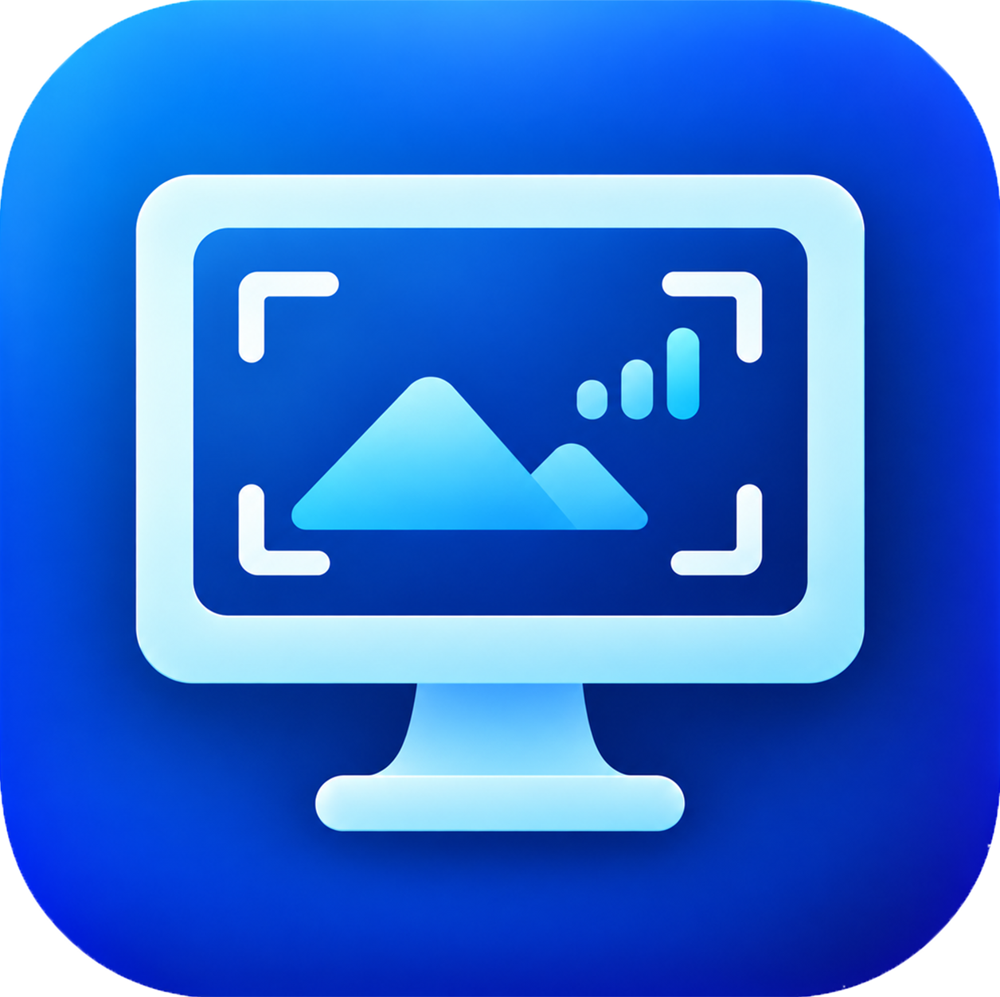

# TrackMirror for Hubstaff



Privacy-first Hubstaff companion for Windows — instant screenshot previews, activity analytics, local AI privacy scans, and timer controls.

TrackMirror helps you review local copies of Hubstaff screenshots, flag sensitive captures and
understand your activity throughout the day.
English is the default interface language; Russian is also available. This independent project is not
affiliated with or endorsed by Hubstaff.

## Download and run

Open this repository's **Releases** page and choose one Windows x64 download:

- **Installer:** `TrackMirror-v<VERSION>-win-x64-setup.exe`. Installs for your Windows account,
  adds a Start menu shortcut and appears in Installed apps. Administrator access is not required.
- **Portable ZIP:** `TrackMirror-v<VERSION>-win-x64.zip`. Extract the complete archive into
  a writable folder and run `TrackMirror.exe`.

- Windows x64 is required. Both formats include the .NET 10 desktop runtime.
- Keep the `ru`, `privacy-models`, `licenses` and runtime files beside the executable.
- The viewer requires no Hubstaff login, API token, Python installation or administrator access.
- Optional AI models are downloaded separately in Settings and are not bundled in release ZIPs.
- Preview builds are unsigned. Check the installer or ZIP against the release's `SHA256SUMS.txt`.

Exit the viewer from the tray before updating or uninstalling. Run a newer installer to update the
same installation. Uninstalling removes installed program files and shortcuts, while retaining history,
settings, backups and downloaded models. There is no automatic updater. See [RELEASING.md](RELEASING.md)
for build commands and the current x86 limitation.

A source checkout requires .NET 10 SDK. Framework-dependent builds require .NET 10 **Desktop Runtime**
on the destination computer; the ordinary .NET Runtime is insufficient.

## Features

- Dark thumbnail gallery, All/Flagged/Unread/AI risks filters and inclusive date ranges.
- Thumbnail selection, bulk Mark as read with Undo, and per-run AI categories.
- Full-image fit, zoom, panning, keyboard controls and shared custom scrollbars.
- Focus-preserving preview notifications with configurable timeout and an off switch.
- Experimental screenshot countdown from local Hubstaff logs, with tray/app status and configurable desktop widgets.
- Tray controls and optional startup alongside Hubstaff.
- Opt-in idle-triggered Hubstaff CLI control: pause/resume or periodic stop/resume, with configurable timing.
- Locally received activity intervals, account selection and daily graphs.
- Optional local AI checks for secrets/personal data, games and personal chats.
- Durable AI queue, per-category coverage, partial results and manual additional checks.
- Pinned model selection, download/removal, cancellation and resumable downloads.
- SQLite metadata, recoverable legacy JSON import, folder transfer, backups/restores and retention.
- Saved English/Russian interface selection.

Hubstaff can remove originals quickly; the viewer cannot guarantee capture of every screenshot.
**Deleting a viewer copy does not delete a screenshot already stored by Hubstaff.** AI suggestions
need manual review; an empty result is not proof that an image is safe.

## Screenshot timer (experimental)

Enable the screenshot timer in Settings and choose a display mode:

- **Default:** countdown on tray hover and beside the application's navigation.
- **Detailed:** a continuous, compact desktop widget showing only the countdown digits.
- **Before screenshot:** the widget appears during the last configured seconds before a planned capture.

Configure appearance/hiding thresholds, scale, background opacity and final-second highlighting.
The widget saves its position and supports optional click-through with middle-button dragging.
Positioning controls are also available from the tray. There is no sound or focus change.

The timer is disabled by default and follows planned capture attempts from Hubstaff's local logs.
Schedules can change, captures can be skipped, and stopping or switching tasks may trigger an immediate
screenshot. Scheduled hiding cannot guarantee that the widget stays out of every capture.
See [USER_GUIDE.md](USER_GUIDE.md#screenshot-timer-experimental) for details.

## Getting started

1. Start the viewer; it discovers `%APPDATA%\Hubstaff\data\hubstaff.com` automatically.
2. Start tracking in Hubstaff. Initial available JPGs are imported without notifications.
3. Open a thumbnail or notification to review an image.
4. Use Reviewed or Flag to record your decision. Thumbnail viewing alone does not mark it reviewed.
5. Close the main window to keep monitoring in the tray; use Exit application to stop it.

Settings contains language, notifications, startup, the screenshot timer, Hubstaff timer control, AI and
storage options. A language change applies
after exiting from the tray and restarting. Automatic AI scanning, timer control and cleanup are off by default.
Retention defaults to 30 days, with flagged/unread screenshots protected by default.
See [USER_GUIDE.md](USER_GUIDE.md) for detailed instructions.

## Privacy and data

Read [PRIVACY.md](PRIVACY.md) before handling sensitive images. The viewer has no application analytics,
Hubstaff API client or cloud AI provider. Configured local inference uses a private loopback Ollama
process; installation makes external download requests. Images, metadata and backup ZIPs are unencrypted.
Optional timer control uses the installed Hubstaff CLI and requires Scripted control permission.
Hubstaff continues to manage its own captures, uploads and server records.

Fresh installations store history under
`%LOCALAPPDATA%\TrackMirror\installations\<installation-id>\data`.
Existing portable installations retain executable-adjacent `data` folders. Settings shows the active
folder and can move it to another empty local folder. Transfers retain source files for recovery.
Installed AI models remain under the executable's `privacy-runtime` folder.

## Build from source

Use Windows, PowerShell 7 and the SDK selected by `global.json`:

```powershell
dotnet restore .\TrackMirror.sln --locked-mode
dotnet build .\TrackMirror.sln -c Release --no-restore -m:1 -nr:false
dotnet run --project .\src\TrackMirror.App\TrackMirror.App.csproj
```

Create the self-contained release and corresponding source archives. Add `-BuildInstaller` when
[Inno Setup 6.3 or newer](https://jrsoftware.org/isdl.php) is installed:

```powershell
pwsh -File .\scripts\Build-Release.ps1 -Version 1.0.0 -BuildInstaller
pwsh -File .\scripts\Export-Source.ps1 -Version 1.0.0
```

Assets appear under ignored `artifacts/releases`. Packaging uses fresh staging and never copies an
existing `publish`, user dataset or downloaded model directory.

## Command-line options

| Option | Purpose |
| --- | --- |
| `--source-root "path"` | Root containing account `screens` folders. |
| `--data-root "path"` | Override the saved data folder; completed transfers are followed. |
| `--background` | Start in the tray. |
| `--no-previews` | Disable notifications for this session. |

```powershell
.\TrackMirror.exe --data-root "D:\TrackMirrorData" --background
```

One viewer instance runs per data folder.

## Development

Read [CONTRIBUTING.md](CONTRIBUTING.md), [RELEASING.md](RELEASING.md), [SECURITY.md](SECURITY.md) and
[CHANGELOG.md](CHANGELOG.md). GitHub Actions validates/builds on Windows and runs synthetic integration
checks for pull requests and pushes to `main`. Version tags generate archives and a draft Release.
Local builds do not prove hosted Actions succeeded.

Public documentation is in the repository root and uses English. Internal planning/specifications stay
in ignored `docs` and are excluded from public source archives. Russian translations and multilingual
synthetic fixtures remain application assets.

## License

First-party source is licensed under **MPL-2.0**; see [LICENSE](LICENSE) and
[Mozilla's MPL FAQ](https://www.mozilla.org/en-US/MPL/2.0/FAQ/). Releases include corresponding source
and notices. Dependencies and OCR/model assets retain their own terms; see
[THIRD-PARTY-NOTICES.md](THIRD-PARTY-NOTICES.md) and `licenses/`.
